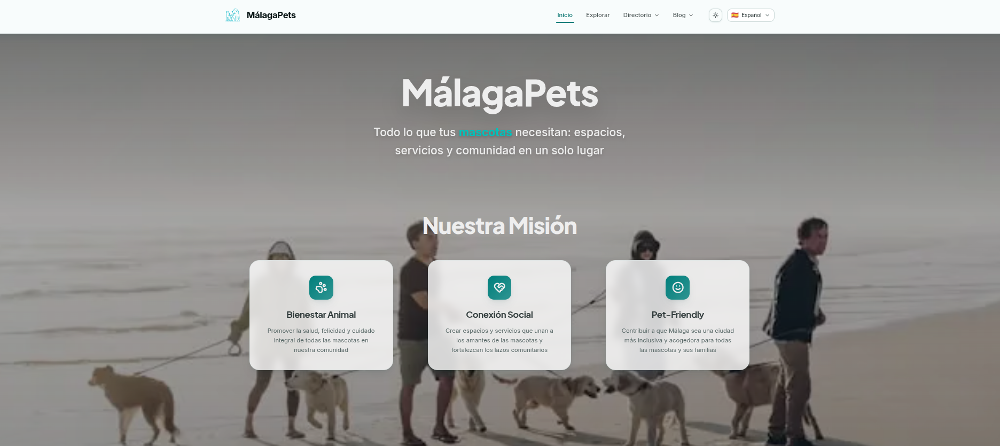

# 🐾 MálagaPets

[Next.js](https://nextjs.org/) [TypeScript](https://www.typescriptlang.org/) [Tailwind CSS](https://tailwindcss.com/) [Deployed on Vercel](https://vercel.com/)

> 🚧 **Proyecto en desarrollo activo** — el proyecto está en construcción continua. Se irán subiendo nuevas funcionalidades, mejoras de rendimiento y contenido de forma progresiva. Cualquier feedback es bienvenido.

Guía pet-friendly de Málaga: playas caninas, parques, veterinarios y blog con consejos, todo en un mapa interactivo y disponible en 4 idiomas.



**🌐 Web:** [malagapets.com](https://malagapets.com/)  
**📸 Instagram:** [@malagapets](https://www.instagram.com/malagapets/)

## ✨ Características

- 🗺️ **Explorador interactivo** — playas caninas, parques y veterinarios de Málaga georreferenciados en un mapa (Leaflet)
- 📚 **Directorios** con buscador, filtros y fichas detalladas de cada recurso
- 📝 **Blog multiidioma** con guías, categorías, autores, archivo y búsqueda
- 🌍 **4 idiomas** (es, en, fr, de) con rutas traducidas y SEO completo (hreflang, canonicals, sitemap)
- 🌗 **Modo claro/oscuro** y diseño accesible (WCAG)
- 📡 **Datos**: Portal de Datos Abiertos del Ayuntamiento de Málaga y recopilación propia

## 🛠️ Stack

| Área               | Tecnología                         |
| ------------------ | ---------------------------------- |
| Framework          | Next.js 16 (App Router, Turbopack) |
| Lenguaje           | TypeScript                         |
| Estilos            | Tailwind CSS                       |
| i18n               | next-intl (rutas localizadas)      |
| Mapas              | Leaflet                            |
| Contenido          | MDX + JSON (file-based CMS)        |
| Gestor de paquetes | pnpm (workspace/monorepo)          |
| Despliegue         | Vercel                             |

## 📁 Estructura del monorepo

```
malagapets/
├── backend/             # API Next.js + contenido (file-based CMS)
│   ├── app/api/         # Endpoints: posts, categories, authors, beaches, veterinary, search
│   ├── content/         # Posts MDX (4 idiomas), categorías, autores, tags, datos
│   └── lib/             # Parser MDX, servicios de datos, caché
│
├── frontend/            # Web pública Next.js
│   ├── src/app/         # Rutas con [locale], sitemap, robots
│   ├── src/components/  # UI: blog, mapas, directorios, layouts
│   ├── src/i18n/        # Configuración next-intl y pathnames traducidos
│   └── src/messages/    # Traducciones es/en/fr/de
│
└── pnpm-workspace.yaml


```

## 🚀 Desarrollo local

**Requisitos:** Node.js 20+ y pnpm 11+

```bash
# 1. Clonar e instalar
git clone https://github.com/nuriadevs/malagapets.git
cd malagapets
pnpm install

# 2. Variables de entorno
cp frontend/.env.example frontend/.env.local
cp backend/.env.example backend/.env.local
# (editar con tus valores)

# 3. Arrancar backend + frontend en paralelo
pnpm dev


```

- Frontend: http://localhost:3000
- Backend API: http://localhost:3001

### Scripts disponibles

```bash
pnpm dev          # backend + frontend en paralelo
pnpm build        # build de producción (backend primero, luego frontend)
pnpm lint         # lint de ambos paquetes
pnpm type-check   # comprobación de tipos de ambos paquetes


```

## 🔑 Variables de entorno

**frontend/.env.local**

| Variable               | Descripción                                        |
| ---------------------- | -------------------------------------------------- |
| `NEXT_PUBLIC_API_URL`  | URL del backend (`http://localhost:3001` en local) |
| `NEXT_PUBLIC_SITE_URL` | URL pública del sitio (`https://malagapets.com`)   |

**backend/.env.local**

| Variable         | Descripción                                           |
| ---------------- | ----------------------------------------------------- |
| `ALLOWED_ORIGIN` | Origen permitido para CORS (`https://malagapets.com`) |

## ✍️ Añadir contenido

Los posts del blog son archivos **MDX** en `backend/content/posts/{idioma}/`:

1.  Crea el archivo `mi-nuevo-post.mdx` en `backend/content/posts/es/`
2.  Añade el frontmatter (title, slug, description, tags, cover, seo, localizations...)
3.  Crea las versiones traducidas en `en/`, `fr/` y `de/` con sus propios slugs
4.  Enlaza los idiomas entre sí mediante el campo `localizations` del frontmatter
5.  Si usas tags nuevas, regístralas en `backend/content/tags/tags.{idioma}.json`

## 🌍 i18n

- Rutas traducidas por idioma definidas en `frontend/src/i18n/pathnames.ts` (ej.: `/es/explorar` ↔ `/en/explorer` ↔ `/de/erkunden`)
- Textos de UI en `frontend/src/messages/{es,en,fr,de}.json`
- SEO multiidioma: canonicals + hreflang generados con `frontend/src/lib/seo.ts` y sitemap por idioma en `src/app/sitemap.ts`

## ☁️ Despliegue

El monorepo se despliega como **dos proyectos en Vercel** desde el mismo repositorio:

| Proyecto | Root Directory | Dominio              |
| -------- | -------------- | -------------------- |
| Frontend | `frontend`     | `malagapets.com`     |
| Backend  | `backend`      | `api.malagapets.com` |

Cada push a `main` redespliega automáticamente.

## 📊 Fuentes de datos

- **Parques caninos**: [Portal de Datos Abiertos del Ayuntamiento de Málaga](https://datosabiertos.malaga.eu/dataset/parques-caninos) (CC BY 4.0).
- **Playas caninas**: recopilación propia a partir de información publicada por los ayuntamientos de la provincia.
- **Veterinarios**: recopilación propia a partir de información pública de cada clínica.

Detalle completo, licencias y atribuciones en [DATA_SOURCES.md](https://github.com/nuriadevs/malagapets/blob/main/DATA_SOURCES.md).

## 🤖 Herramientas de IA en el flujo de trabajo

Proyecto desarrollado con un flujo asistido por IA: Claude Code como apoyo para generar componentes, depurar y revisar código; borradores del blog y traducciones generados con IA y revisados manualmente. La arquitectura, las decisiones técnicas y la validación final son trabajo propio.

> Trabajar con tecnología en evolución continua ha sido parte del aprendizaje del proyecto: saber cuándo apoyarse en la IA, cómo guiarla y dónde aplicar criterio propio.

## 📄 Licencia

© 2026 Nuria. Todos los derechos reservados.

Este repositorio se publica **solo con fines de portfolio** . Ver [LICENSE](https://github.com/nuriadevs/malagapets/blob/main/LICENSE).

Los datos de terceros no están cubiertos por esta licencia y mantienen sus propios términos ([DATA_SOURCES.md](https://github.com/nuriadevs/malagapets/blob/main/DATA_SOURCES.md)).

---

Desarrollado con ❤️ por **Nuria**  
[Instagram](https://www.instagram.com/malagapets/)
